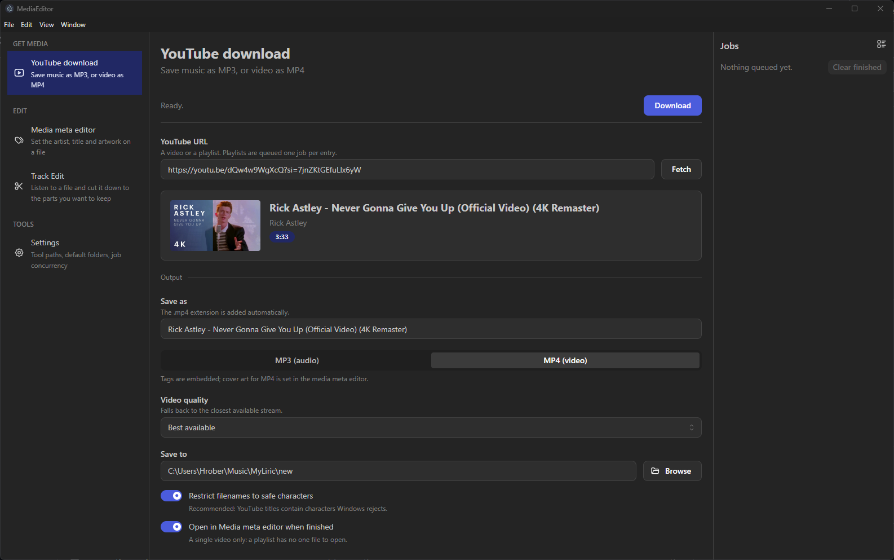
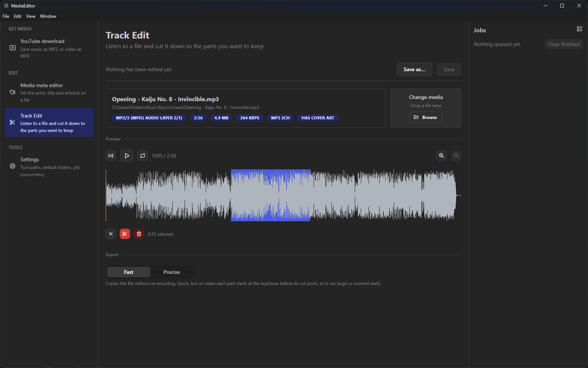

# MediaEditor

**A simple, fast desktop tool for your music and video files.** Paste a YouTube
link and get a tagged MP3 with cover art. Drop a file in to fix its artist, title
or cover. Cut out the parts you do not want and save. No accounts, no cloud,
nothing leaves your machine.





## What it does

- **YouTube download.** Paste a video or playlist URL, see what it is, pick MP3
  or MP4, and go. MP3s arrive with tags and cover art already embedded. Live
  progress, a cancel that really stops everything, and yt-dlp's own error
  message when something goes wrong.
- **Media meta editor.** Set artist, title, album, year, genre and cover art on
  an MP3 or MP4. Pick, drop or paste an image, or grab a frame from the video.
- **Track Edit.** See the waveform, play it back, select a part and cut, delete
  or paste it somewhere else. Export fast (no re-encoding) or precise (exact to
  the frame).

Saving never puts your original at risk: every change is written to a temporary
copy, checked, and only then swapped in.

## Install

Download the installer from the
[latest release](https://github.com/Hrober0/MediaEditor/releases/latest).

MediaEditor uses a few free tools that you install once:

| Tool                 | Used for                                  |
| -------------------- | ----------------------------------------- |
| `ffmpeg` / `ffprobe` | everything audio and video                |
| `yt-dlp`             | downloading; keep it updated              |
| Deno or Node.js      | needed by yt-dlp to download from YouTube |

On Windows:

```
winget install ffmpeg
winget install yt-dlp
winget install DenoLand.Deno
```

On Linux, use your package manager for ffmpeg and
[yt-dlp's own instructions](https://github.com/yt-dlp/yt-dlp#installation),
since distribution packages are often too old for YouTube.

If a tool is missing, the app opens on a setup screen saying which one, and you
can point it at a tool installed somewhere unusual in Settings.

Linux builds (AppImage and `.deb`) are produced but not yet tested.

## Building from source

Needs Node.js 22.

```
npm install
npm run dev       # run it with hot reload
npm run package   # installer for your platform, written to release/
```

`npm test` runs the unit tests (no network) and `npm run test:integration` runs
the ones that drive the real ffmpeg and yt-dlp. Code conventions and the project
layout are in [CLAUDE.md](CLAUDE.md).

## Roadmap

Next up is a media library: point it at a folder, see everything grouped by
genre, artist or album, and drag files between groups to retag them. The full
plan is in [roadmap.md](roadmap.md), and what is already built, with dates, is in
[done.md](done.md).

## License

[MIT](LICENSE)
